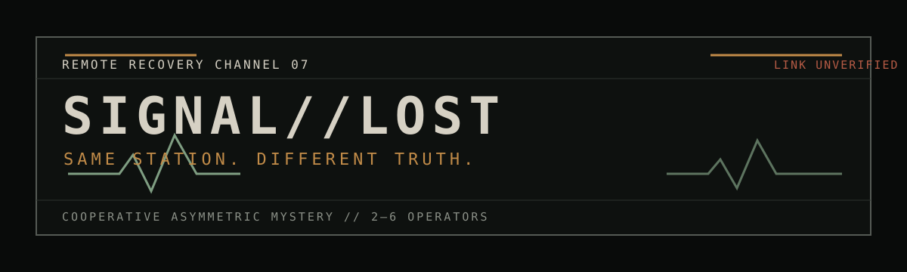
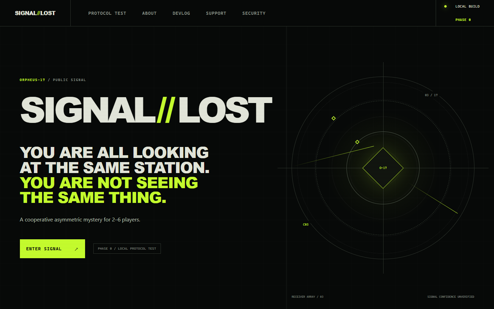

<p align="center">
  
</p>

# SIGNAL//LOST

SIGNAL//LOST is an asymmetric cooperative browser mystery for two to six players. Every operator connects to the same station, but the server exposes different evidence to each role.

## Current status

The project is in Phase 0: Protocol Boot. The repository foundation, first public interface, protocol boundary, and a small deterministic contradiction-engine slice are under active development.

The protocol, scenario format, and save compatibility may change before 1.0. There is no public server or published release yet.

<p align="center">
  
</p>

## The first signal

ORPHEUS-17 is an abandoned deep-space communications station transmitting again after eleven years. Operations may see an open bulkhead while Archives has a record showing that the same bulkhead was permanently sealed. Neither client receives the complete canonical state.

The first vertical slice focuses on one contradiction:

- Operations sees `DOOR C03: OPEN`.
- Archives sees `DOOR C03: SEALED SINCE 11 YEARS`.
- Operations submits an intent to close the door.
- The server decides the canonical result and produces a new role-specific projection.

## Architecture boundary

Clients send validated intents. Only the server mutates canonical game state, advances revisions, evaluates permissions, and generates player projections. Canonical facts, scenario seeds, private drift values, and other players' evidence must never be placed in browser payloads.

The workspace is intentionally small:

```text
apps/web              public site and role interfaces
apps/server           authoritative HTTP and WebSocket service
packages/protocol     client-safe versioned wire schemas
packages/game-engine  deterministic server-only state transitions
packages/scenario-sdk declarative scenario validation
scenarios             versioned mission data
```

See [Architecture](docs/ARCHITECTURE.md) and [Security model](docs/SECURITY_MODEL.md) for the current boundaries.

## Run locally

Requirements:

- Node.js 24 LTS
- Corepack
- pnpm 11.21.0

```text
corepack enable pnpm
pnpm install
pnpm setup
pnpm dev
```

`pnpm setup` creates an ignored `.env.local` with a cryptographically random local session secret. PostgreSQL is optional for the Phase 0 slice. When Docker Compose is available, the setup command starts the declared local database service.

## Verification

```text
pnpm lint
pnpm typecheck
pnpm test
pnpm scenario:validate
pnpm legal:check
pnpm privacy:check
pnpm assets:check
pnpm brand:check
pnpm build
pnpm smoke:server
pnpm test:e2e
```

`pnpm release:check` is intentionally stricter than a development build. It must fail while required operator information remains unresolved.

## Privacy

The browser application loads no advertising, behavioral analytics, remote fonts, remote media, or third-party runtime scripts. The current Phase 0 interface does not require an account and does not use browser storage. These statements describe the current implementation, not a legal certification.

See [PRIVACY.md](PRIVACY.md) and the [privacy data map](docs/PRIVACY_DATA_MAP.md).

## Scenarios

Scenarios are declarative data validated by the Scenario SDK. Scenario packages cannot execute arbitrary JavaScript. Mission source contains spoilers by design; runtime secrecy is enforced through server-side projection, not source obfuscation.

See [Scenario authoring](docs/SCENARIO_AUTHORING.md).

## Contributing and security

Read [CONTRIBUTING.md](CONTRIBUTING.md) before proposing changes. Do not report suspected vulnerabilities through a public issue; follow [SECURITY.md](SECURITY.md).

## License

SIGNAL//LOST is licensed under the [MIT License](LICENSE). Third-party components retain their own licenses; see [THIRD_PARTY_NOTICES.md](THIRD_PARTY_NOTICES.md).
