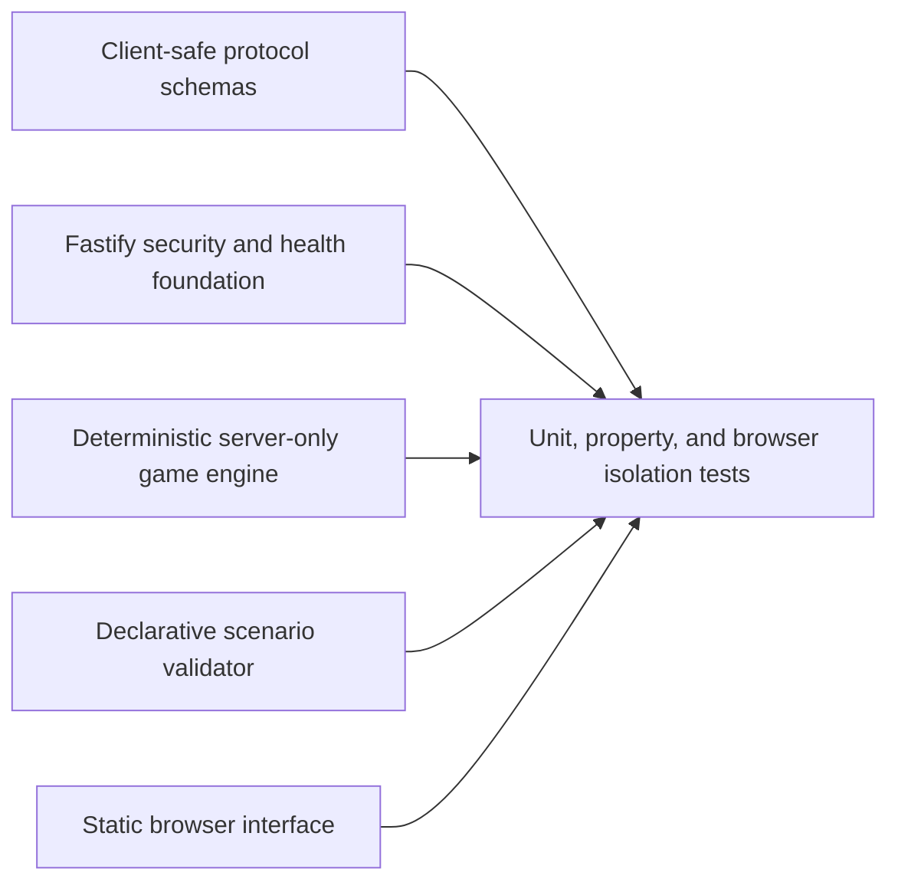

# Architecture

## Current Phase 0 foundation



The repository currently implements and tests the layers independently. It does not yet expose a gameplay WebSocket route, establish player identity, or deliver live snapshots and events. Protocol packages contain only types that are safe to serialize across the future connection boundary, and projection tests verify that canonical secrets do not enter player DTOs.

## Dependency direction

```text
web -> protocol
server -> protocol + game-engine + scenario-sdk
game-engine -> pure domain interfaces
scenario-sdk -> declarative scenario data
```

The web application must not depend on game-engine implementation or scenario source. The engine remains deterministic: a scenario version, seed, prior state, and accepted intent produce a reproducible result.

## Target revision and intent flow

The engine and schema rules below are implemented and tested. Connection identity, live transport, session orchestration, and per-player delivery remain Phase 1 work.

1. A connection establishes actor identity outside the action payload.
2. The client submits an action ID, expected revision, and bounded intent.
3. The server validates the message, session, role, capability, revision, and replay state.
4. An accepted mutation advances the canonical revision exactly once.
5. The server regenerates a separate projection for each affected player.
6. Rejected, stale, or duplicate actions do not mutate state.

Gameplay transport, persistence, reconnect, and production hosting are later milestones. This document does not claim that any of them are currently deployed.
