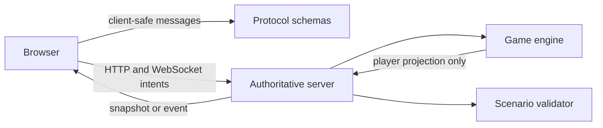

# Architecture

## Current system



The browser never receives the canonical world, server seed, drift values, private decisions, or another player's projection. Protocol packages contain only types that are safe to serialize across the trust boundary.

## Dependency direction

```text
web -> protocol
server -> protocol + game-engine + scenario-sdk
game-engine -> pure domain interfaces
scenario-sdk -> declarative scenario data
```

The web application must not depend on game-engine implementation or scenario source. The engine remains deterministic: a scenario version, seed, prior state, and accepted intent produce a reproducible result.

## Revision and intent flow

1. A connection establishes actor identity outside the action payload.
2. The client submits an action ID, expected revision, and bounded intent.
3. The server validates the message, session, role, capability, revision, and replay state.
4. An accepted mutation advances the canonical revision exactly once.
5. The server regenerates a separate projection for each affected player.
6. Rejected, stale, or duplicate actions do not mutate state.

Persistence and production hosting are later milestones. This document does not claim that either is currently deployed.
